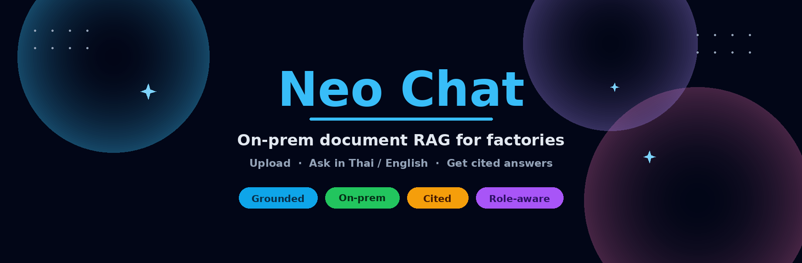
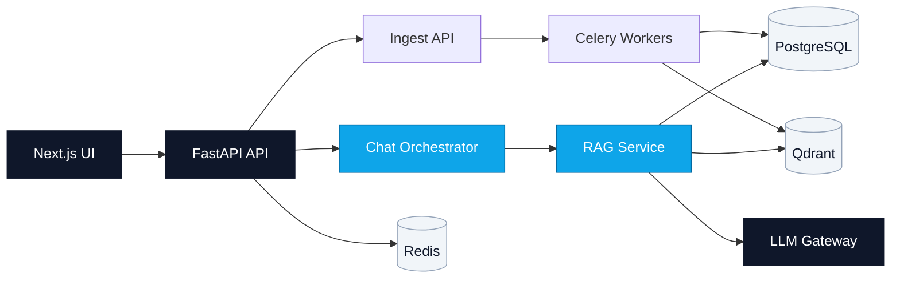

<div align="center">



<br />

[](https://github.com/CPF-Chula-CEDT-2026/spark/actions/workflows/ci.yml)
[](./CHANGELOG.md)
[](./pyproject.toml)
[](./web/package.json)
[](./LICENSE)

<br />

[Why](#why-neo-chat) ·
[Quick Start](#quick-start) ·
[Product](#product-surface) ·
[Architecture](#architecture) ·
[Docs](#documentation) ·
[Contributing](#contributing--community)

</div>

---

## Why Neo Chat

| Grounded answers | On-prem only | Role-aware access |
| --- | --- | --- |
| Every reply cites the source document — no free-form hallucination. | Runs end-to-end on the factory LAN. Nothing leaves your network. | Users, job positions, and document releases control who sees what. |

---

## Overview

Neo Chat focuses on one core workflow:

```text
  Upload          Ingest + Index         Ask in chat           Manage
  PDF / DOCX  →   Postgres + Qdrant  →   cited answers     →   users · ACL
  XLSX / IMG      chunks & vectors       Thai / English        feedback
```

Answers come only from the uploaded document index.

| Layer | Technology |
| --- | --- |
| API | FastAPI (Python 3.11+) |
| Web | Next.js 14 (TypeScript) |
| Background jobs | Celery |
| Data | PostgreSQL · Qdrant · Redis · MinIO |
| LLM | Configurable gateway (Ollama or a remote profile) |

---

## Quick Start

<details open>
<summary><strong>1. Infrastructure + API</strong></summary>

```bash
docker compose up -d
python3.12 -m venv .venv
source .venv/bin/activate
pip install -e ".[dev]"
alembic upgrade head
python scripts/init_db.py
uvicorn spark.main:app --reload --port 8000 --app-dir src
```

</details>

<details open>
<summary><strong>2. Background worker</strong> (separate terminal)</summary>

```bash
celery -A spark.workers.celery_app worker --concurrency=1 --loglevel=info
```

</details>

<details open>
<summary><strong>3. Web UI</strong> (separate terminal)</summary>

```bash
cd web
npm install
npm run dev
```

</details>

| Service | URL |
| --- | --- |
| Web UI | http://localhost:3000 |
| API docs (Swagger) | http://localhost:8000/docs · https://neospark.kcalsion.com/docs |

> Deploying to a factory LAN or Jetson? See [`deploy/README-ONPREM.md`](./deploy/README-ONPREM.md) and [`deploy/jetson/README.md`](./deploy/jetson/README.md).

---

## Product Surface

| Route | Who | What |
| --- | --- | --- |
| `/chat` | everyone | Document-grounded Q&A — streaming answers + citations |
| `/documents` | everyone | Browse and open indexed documents |
| `/upload` | write access | Upload documents and monitor ingest jobs |
| `/feedback` | write access | Report a wrong or incomplete answer |
| `/machines` | write access | Machine registry |
| `/admin` | admin | Users, job positions, document access, feedback triage |
| `/admin/factories` | admin | Factory configuration |
| `/system-admin` | admin | Ops health — traffic, latency, ingest, dependency status |
| `/account` `/login` `/signup` `/privacy` | everyone | Account and auth flows |

---

## Architecture



Requests flow from the web UI through the API to either the **chat/RAG path** (retrieval + generation, grounded in Postgres and Qdrant) or the **ingest path** (async processing via Celery).

Full breakdown → [`docs/architecture.md`](./docs/architecture.md)

---

## Repository Layout

```text
src/spark/          FastAPI API, ingestion, retrieval, chat orchestration
web/                Next.js frontend
configs/            RAG, ingestion, compliance, and evaluation config
docs/               Product and engineering docs
tests/              Python tests
alembic/versions/   Database migrations
deploy/             On-prem and Jetson deployment kits
gpu-sidecar/        Host-side embed/rerank service (CUDA)
assets/neo/         Brand artwork
```

---

## Documentation

> **Start here:** [`docs/HANDOVER.md`](./docs/HANDOVER.md) is the authoritative, code-grounded project handover — trust it when other docs disagree.

| Document | Purpose |
| --- | --- |
| [docs/HANDOVER.md](./docs/HANDOVER.md) | Authoritative handover — architecture, config, ops, secrets |
| [docs/DELIVERY_ACCEPTANCE.md](./docs/DELIVERY_ACCEPTANCE.md) | Delivery scope, acceptance tests, warranty, sign-off |
| [docs/user-guide.md](./docs/user-guide.md) | Operator user guide |
| [docs/admin-guide.md](./docs/admin-guide.md) | Admin guide |
| [docs/architecture.md](./docs/architecture.md) | System architecture |
| [docs/api-overview.md](./docs/api-overview.md) | API map |
| [docs/public-api-integration.md](./docs/public-api-integration.md) | Third-party API integration |
| [docs/operations-guide.md](./docs/operations-guide.md) | Install, config, backup, monitoring |
| [docs/demo_playbook.md](./docs/demo_playbook.md) | Scripted walkthrough for demos |
| [web/README.md](./web/README.md) | Frontend developer guide |
| [gpu-sidecar/README.md](./gpu-sidecar/README.md) | GPU embed/rerank sidecar setup |
| [CHANGELOG.md](./CHANGELOG.md) | Release history |

---

## Contributing & Community

| Document | Purpose |
| --- | --- |
| [CONTRIBUTING.md](./CONTRIBUTING.md) | Dev setup, branch workflow, versioning |
| [CODE_OF_CONDUCT.md](./CODE_OF_CONDUCT.md) | Expected behavior for contributors |
| [GOVERNANCE.md](./GOVERNANCE.md) | Project decision-making and roles |
| [SECURITY.md](./SECURITY.md) | How to report a vulnerability |
| [.github/SUPPORT.md](./.github/SUPPORT.md) | Where to get help |

---

## Branches & Releases

| Branch | Role |
| --- | --- |
| `main` | Production-ready |
| `develop` | Integration — target feature PRs here |

Releases are tagged `vX.Y.Z` on `main` and recorded in [CHANGELOG.md](./CHANGELOG.md). See [CONTRIBUTING.md](./CONTRIBUTING.md) for the full workflow.

---

<div align="center">

**Proprietary** — see [LICENSE](./LICENSE)

</div>
