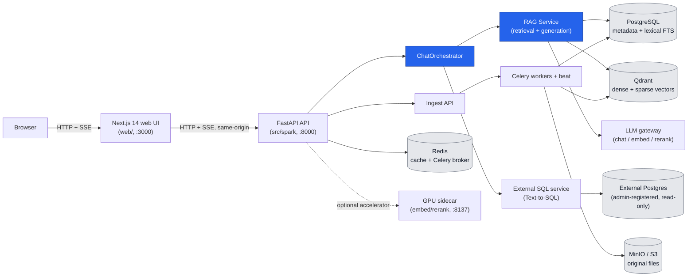

# Architecture

Neo Chat is an on-prem, document-grounded RAG (Retrieval-Augmented
Generation) application with a secondary Text-to-SQL path for analytic
questions against a registered external database. This document is the
system-level architecture reference; for a full engineering-level handover
(config, credentials, runbooks) see [`docs/HANDOVER.md`](./HANDOVER.md), and
for the delivered/partial/out-of-scope boundary of everything described
here see [`docs/DELIVERY_ACCEPTANCE.md`](./DELIVERY_ACCEPTANCE.md).

## Contents

- [Component overview](#component-overview)
- [How a question gets answered](#how-a-question-gets-answered)
- [The ingestion pipeline](#the-ingestion-pipeline)
- [Data layer](#data-layer)
- [Security layer](#security-layer)
- [Deployment topologies](#deployment-topologies)
- [Repository layout](#repository-layout)
- [Related docs](#related-docs)

## Component overview



| Component | Role |
| --- | --- |
| **Web** (`web/`) | Next.js 14 app-router frontend. Thin client — no business logic, calls the API for everything, streams chat via SSE |
| **API** (`src/spark/`) | FastAPI backend. ~96 routes across ~20 routers under `/api/v1`, plus root health endpoints |
| **ChatOrchestrator** (`services/chat_orchestrator.py`) | The brain of every chat turn — routes each question to the right answer pipeline |
| **RAG Service** (`retrieval/`, `generation/`) | Hybrid retrieval + grounded generation for document Q&A |
| **External SQL service** (`services/external_sql/`, `services/agentic/query_database.py`) | Read-only Text-to-SQL against an admin-registered external Postgres database |
| **Celery workers + beat** (`workers/`) | Async ingestion, OCR, reconciliation, cleanup, scheduled maintenance |
| **PostgreSQL** | System of record: users, documents, chat, feedback, audit, and Thai full-text search |
| **Qdrant** | Vector store for dense (and optional sparse) retrieval |
| **Redis** | Cache, Celery broker, rate-limit/session-version state |
| **MinIO (or local disk)** | Object storage for original uploaded files, quarantine artifacts, chat/feedback attachments |
| **GPU sidecar** (`gpu-sidecar/`) | Optional host-side accelerator for embedding/reranking on a GPU (e.g. Jetson); the app falls back to CPU/remote paths if it's absent |
| **LLM gateway** | External chat/embedding/reranking backend, selected via a named profile in `configs/llm_profiles.yaml` (Ollama, a hosted gateway, or a mix) |

## How a question gets answered

`ChatOrchestrator` dispatches every chat turn to one of several pipelines —
this is a routing decision made per question, not a fixed single path:

1. **Machinery pipeline** — the primary RAG path over machine manuals,
   SOPs, drawings, datasheets, inspection reports, etc. (Qdrant `spark_docs`
   collection family). The default and most-developed path.
2. **Enterprise pipeline** — RAG over HR/policy documents
   (`company_policy`, `hr_handbook`, `internal_guideline`), served from the
   `spark_enterprise_docs` collection.
3. **External SQL (Text-to-SQL)** — for analytic questions, routes to a
   live, admin-registered external Postgres database
   (see [Admin Guide § External Postgres](./admin-guide.md#external-postgres-tab-text-to-sql)).
   Supports **compound** questions that merge a SQL-derived answer with a
   document-derived one in a single response.
4. **Chitchat** — greetings and identity questions answered directly,
   without retrieval.
5. **Agentic (canary)** — an experimental tool-calling path served to a
   small percentage of sessions when enabled, with an automatic safety
   fallback to the standard path if anything goes wrong.

Routing is a cascade: deterministic chitchat detection → explicit
enterprise scope → a cheap keyword hint → (if still ambiguous) one
context-aware LLM "scope judge" call → sticky prior scope for the session →
default to machinery. A locked machine (set via the chat UI) forces the
machinery pipeline regardless of the above.

### Request flow for a chat question

```
POST /api/v1/chat/sessions/{id}/ask   (or the streaming SSE variant)
  → auth middleware resolves a Principal (JWT / stream ticket / demo mode)
  → ChatOrchestrator.ask() / ask_stream()
      → merge session slots (machine lock, revision, factory) + request filters
      → resolve routing + intent
      → rewrite follow-up questions using session history
      → try external analytics (Text-to-SQL) if the question looks analytic
      → route to chitchat / enterprise / machinery
      → RAGService.query() / query_stream() for the machinery/enterprise paths:
            entry guardrails (query policy, safety-intent check, circuit breaker)
            → hybrid retrieval: dense (bge-m3) + lexical (Postgres Thai FTS) → RRF fusion
            → cross-encoder rerank + absolute relevance gate
            → evidence gates (lexical / extractive / safety-specific)
            → generation: grounded LLM answer → NLI consistency gate → self-verify → citation enforcement
            → fail-closed to "no data" / an extractive span / a flagged-unverified answer as appropriate
      → persist the user + assistant messages, update session slots and title
      → record audit log + question analytics
  → response: answer, source citations, confidence tier, retrieval report, degradation flags
```

See [`docs/architecture/hybrid_retrieval_v2.md`](./architecture/hybrid_retrieval_v2.md)
for the retrieval engine in depth.

## The ingestion pipeline

Runs inside Celery workers, entered via `ingestion/pipeline.py`:

```
upload → parse (streaming, row-by-row) → trust/PII scan → transform/chunk → index → finalize
```

- **13 document-type profiles** in `configs/ingestion/*.yaml`
  (`company_policy`, `hr_handbook`, `internal_guideline`, `machine_manual`,
  `datasheet`, `drawing`, `io_mapping`, `sop`, `inspection_report`,
  `iso_certificate`, `near_miss`, `training_note`, `knowledge_document`),
  each driving parser choice, chunking strategy, target store, and trust
  policy.
- **Parsers**: PDF (layout-aware in production, with a fallback parser in
  dev), Excel, Word, JSON, plain text/Markdown, and image OCR. `drawing`
  documents additionally route dense vector-drawing pages to a **vision
  LLM** that reverse-engineers wiring/schematic pages into structured
  Thai text (device/connection tables, a device→page index, and a
  document-level system overview) — this is the vision-extraction feature
  referenced as [Scope §P-03](./DELIVERY_ACCEPTANCE.md).
- **Trust / PII scan** — detects PII, secrets, and prompt-injection
  patterns. A document can be **quarantined**, requiring a second admin to
  review and release it before it's indexed — see
  [Admin Guide § Document release](./admin-guide.md#document-release-quarantine-review).
- **Chunking** — several strategies (parent/child, semantic-heading,
  SOP-procedure, table-row, page-boundary) selected per document type.
- **Indexing** — dense (and optionally sparse) embedding, written to both
  Postgres (metadata + lexical search) and Qdrant (vectors).
- **Re-ingestion is blue-green**: a re-ingest writes to a staging
  generation, then atomically swaps in and schedules cleanup of the old
  one, so re-indexing is safe to retry and reversible on failure.
- **Reliability**: idempotency keys, per-document locks, retry with
  transient/permanent error classification, a dead-letter queue, and a
  scheduled task that rescues stuck-pending jobs.

## Data layer

| Store | Holds |
| --- | --- |
| **PostgreSQL** (32 tables, Alembic-managed) | Users/roles/factories/job-positions (identity & RBAC), documents & chunks, chat sessions & messages, feedback, ingestion jobs/events/errors, external data-source registrations, and an append-only (WORM-style) audit log |
| **Qdrant** | Two base collection families: `spark_docs` (machinery) and `spark_enterprise_docs` (HR/policy). Sharding is configurable per-factory or single-collection. Vector payloads record embedding provenance so mixed-provider vectors stay reconcilable |
| **Redis** | Query/answer cache, Celery broker, rate limiting, and auth token-version state (used to invalidate sessions immediately on a permission change) |
| **MinIO / local disk** | Original uploaded files, quarantine artifacts, and chat/feedback attachments, behind a storage abstraction that supports either backend |

A scheduled reconciliation task keeps Postgres chunk records and Qdrant
vectors consistent; the same reconciliation can be triggered on demand from
[System Admin § Actions bar](./admin-guide.md#actions-bar) ("Sync Qdrant").

## Security layer

- **Authentication**: JWT bearer tokens (password login) and Google OAuth.
- **Authorization**: role-based (`employee` / `operator` / `admin`, plus a
  separate `is_super_admin` flag) combined with per-factory access levels
  (`read` / `write` / `admin`) — see
  [Admin Guide § Roles & permissions model](./admin-guide.md#roles--permissions-model)
  for the full model.
- **Middleware stack**: rate limiting, request concurrency caps, security
  headers, trusted-proxy handling for client IPs behind nginx/load
  balancers, and a dedicated SSE governance layer (separate admission plane
  for long-lived streaming connections vs. regular request/response calls).
- **Production lock**: a startup check that fails fast if the app is
  launched in a production profile with unsafe defaults (e.g. demo secrets,
  `AUTH_REQUIRED=false`).
- **Secrets**: external data-source credentials are encrypted at rest;
  application secrets live in environment variables, never in the
  repository — see [`docs/DELIVERY_ACCEPTANCE.md` §10](./DELIVERY_ACCEPTANCE.md)
  for the credential-handling rules.

## Deployment topologies

The same application code supports several deployment shapes:

- **Local development** — `docker compose up -d` for infra (Postgres,
  Redis, Qdrant, MinIO) plus the API/web/worker run directly on the host.
- **Factory on-prem kit** (`deploy/`) — a fully self-hosted stack behind
  nginx on a factory LAN, with a local LLM (Ollama) and no cloud
  dependency — see [`deploy/README-ONPREM.md`](../deploy/README-ONPREM.md).
- **Split-compute (Jetson + Mac/host)** — GPU-accelerated embedding/rerank
  via the [GPU sidecar](../gpu-sidecar/README.md), with the main app
  running elsewhere and calling it over HTTP; falls back to CPU paths if
  the sidecar is unreachable.

Operational detail (backups, monitoring, environment variables) lives in
[`docs/operations-guide.md`](./operations-guide.md).

## Repository layout

```text
src/spark/
├── api/            HTTP layer — v1 routers, platform middleware (auth, rate limit, CORS, SSE)
├── core/            Config, DB, cache, auth, security, Qdrant client, LLM profile loading
├── services/         Business logic — chat_orchestrator, external SQL, admin services
├── retrieval/        Hybrid retrieval engine — fusion, rerank, gates, circuit breaker
├── generation/        Answer generation — grounded LLM, NLI gate, self-verify, citations
├── ingestion/         Ingest pipeline — parsers, chunking, trust/PII scan, indexing
├── workers/           Celery app + tasks (ingest, OCR, reconcile, purge)
├── db/models/         SQLAlchemy ORM models (32 tables)
└── schemas/           Pydantic request/response schemas

web/
├── app/               Next.js routes (chat, documents, upload, admin, system-admin, ...)
├── components/        React components grouped by feature
├── lib/                API client, chat streaming, auth, i18n
└── stores/             Zustand state (chat, UI)

configs/         LLM/embedding profiles, per-document-type ingestion config, retrieval tuning, eval suites
alembic/versions/  58 database migrations
deploy/            On-prem deployment kit (compose, nginx, setup script)
gpu-sidecar/       Standalone GPU inference sidecar
tests/             Python test suite (unit, contracts, chaos, compliance, retrieval, ...)
```

## Related docs

- [docs/HANDOVER.md](./HANDOVER.md) — full engineering handover (config,
  credentials, runbooks, testing)
- [docs/architecture/hybrid_retrieval_v2.md](./architecture/hybrid_retrieval_v2.md) — retrieval engine deep dive
- [docs/architecture/import_spine_v2.md](./architecture/import_spine_v2.md) — ingestion architecture deep dive
- [docs/api-overview.md](./api-overview.md) — full API route map
- [docs/admin-guide.md](./admin-guide.md) — admin console and operational actions
- [docs/DELIVERY_ACCEPTANCE.md](./DELIVERY_ACCEPTANCE.md) — what's delivered, partial, and out of scope
